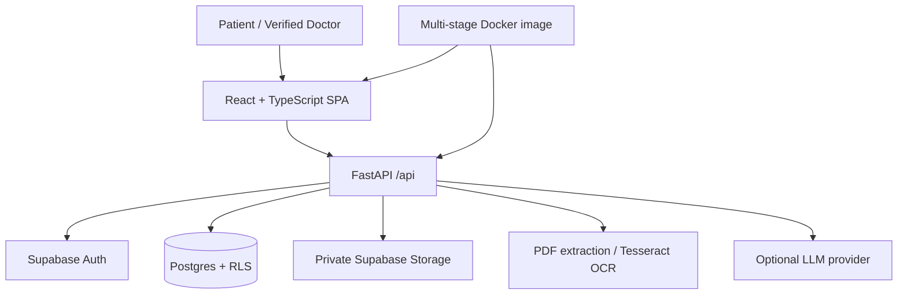

# Patientshell — Patient-centered health records

Patientshell is a React + TypeScript patient portal backed by FastAPI and Supabase. It supports patient-owned medical documents, conservative OCR-assisted extraction with human review, clinician review packages, longitudinal lab comparison, and Dr. Anya's patient-education companion.

> Medical safety: OCR can be wrong and must be checked against the original source. Dr. Anya is educational, not diagnostic, and does not replace professional medical care. This repository does not claim regulatory compliance.

## Architecture



Production uses one origin: FastAPI serves frontend/dist, mounts static files at /assets, and keeps /api/* and /health separate. Without the frontend build, FastAPI remains API-only and Vite runs independently.

## Features

- Supabase Auth with server-side bearer-token validation, patient ownership checks and verified-doctor access.
- Patient portal: profile, visit timeline, questions and medical document list.
- PDF/JPG/PNG upload with a 15 MiB limit, private Storage, OCR/text extraction, source provenance, confidence/review flags and human correction.
- Doctor review queue/packages, short-lived source previews, notes/resolutions, question responses and longitudinal comparisons that flag unit/context mismatches.
- Optional Dr. Anya companion with English/Telugu patient-friendly explanations grounded in extracted facts. Missing provider configuration is reported honestly.
- Targeted pytest tests and GitHub Actions for backend and frontend checks.

## Repository map

```text
backend/app/main.py             FastAPI API + optional SPA serving
backend/app/api/routes/         patient, doctor, documents, AI, identity
backend/app/services/            OCR, extraction, AI adapter, rate limiter
backend/tests/                   pytest suite
frontend/src/                    React pages, auth and portal components
frontend/package.json             Vite build scripts
supabase/migrations/              ordered schema, RLS, Storage and doctor-access SQL
supabase/VERIFICATION.md          migration verification
Dockerfile                        Node builder + Python/OCR runtime
docker-compose.yml                local container test
DEPLOYMENT.md                     production runbook
PROJECT_PROGRESS.md               phase history and closure criteria
```

## Local development

Prerequisites: Python 3.11+, Node 20+, npm, Tesseract and Poppler for scanned OCR, and a Supabase project.

1. Configure backend variables using backend/.env.example. Fill in Supabase URL and anon/publishable key. Configure AI settings only if enabling Dr. Anya.
2. Start API:
   ```sh
   cd backend
   python -m venv .venv
   # Activate the environment, then:
   pip install -r requirements-dev.txt
   uvicorn app.main:app --reload --port 8000
   ```
3. In a second terminal:
   ```sh
   cd frontend
   npm install
   cp .env.example .env.local
   npm run dev
   ```
4. Checks:
   ```sh
   cd backend && pytest
   cd ../frontend && npm run build
   ```

Review supabase/VERIFICATION.md before applying migrations. Never point experimental schema changes at production without an approved migration plan.

## Production Docker

```sh
cp .env.production.example .env
# Fill values; do not commit .env.
docker compose build --no-cache
docker compose up -d
curl -fsS http://localhost:8000/health
docker compose logs -f patientshell
```

Open http://localhost:8000. The image builds the frontend using Node 20, runs FastAPI on Python 3.11 slim, installs Tesseract/Poppler/OpenCV libraries and runs as an unprivileged user. No migrations run automatically. Frontend Supabase values are public build-time settings; AI provider keys stay server-side.

See [DEPLOYMENT.md](DEPLOYMENT.md) for Supabase migration order, environment variables, Render/Railway/Fly.io/cloud-container instructions and troubleshooting.

## Health and security

- GET /health and GET /api/health are liveness endpoints. A healthy response does not prove Supabase, RLS, OCR or AI readiness.
- Keep medical documents in private Supabase Storage; never serve source files from the container filesystem.
- Never expose service-role keys or AI keys in frontend variables.
- Keep RLS enabled and test boundaries using synthetic patient and verified-doctor accounts.
- The review-token limiter is process-local; use shared rate limiting before scaling horizontally.
- Configure HTTPS, backups, access-controlled logs, retention, monitoring and a security/privacy review appropriate to the deployment.

See [PROJECT_PROGRESS.md](PROJECT_PROGRESS.md) for phase history. Phase 10 is complete only after owner review/merge, CI, staging validation and operational sign-off.
